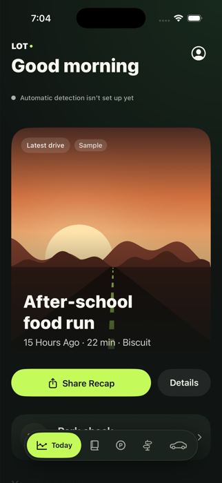
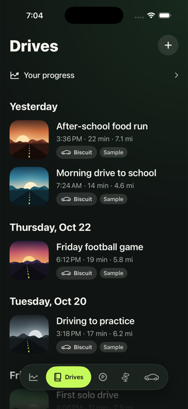
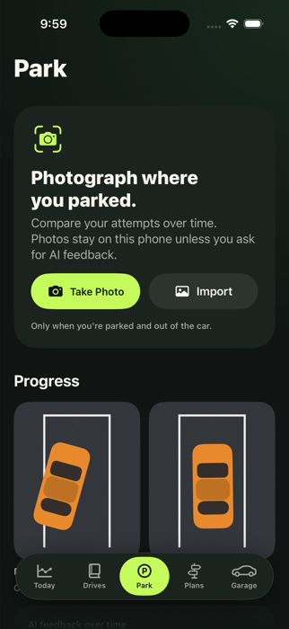
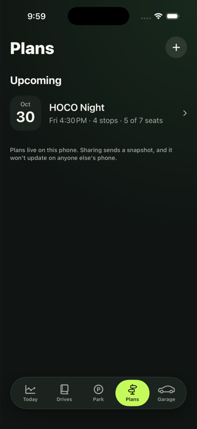
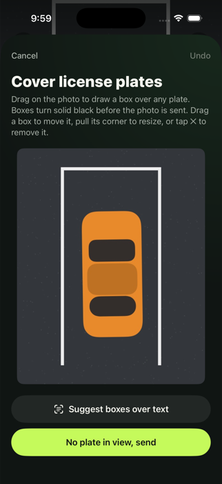

# LOT: Every drive, a little better.

**Congressional App Challenge entry** · native iPhone app (SwiftUI, SwiftData) · iOS 17+

LOT is a private driving companion for high-school students. It records drives with almost no effort, helps new drivers
get better at parking through private feedback, and turns drives and group outings into something easy to share through the
group chats students already use. It is not a social network, a leaderboard, or insurance tracking, and it stays useful even if
no friend ever installs it.

<p>
  
  
  
  
  
</p>

## The problem

- Instagram accounts in our community publicly mock students' bad parking. Embarrassment doesn't make anyone a better driver.
- Driving is a real teenage milestone (the first car, driving to school, Homecoming), but nobody records it.
- Coordinating rides for events like Homecoming is chaos across five group chats.

## What LOT does

| Tab | What it does |
| --- | --- |
| **Today** | One switch for automatic drive detection, your latest drive as a shareable card, a shortcut to the parking photo, and your next plan. |
| **Drives** | Timeline of drives with a real map of the route, notes, several photos per drive, and a question after each detected drive: "Was this you driving?" (I was driving / passenger / this wasn't a drive). |
| **Recap** | Turns a drive into a 1080×1350 image (Night Drive, Photo Dump or Minimal) to share in iMessage, WhatsApp or Instagram. |
| **Park** | After a drive, LOT offers a notification to photograph where you parked, only once you are out of the car. Photos build a private then-and-now history. Optional AI feedback gives qualitative tips, never scores. |
| **Plans** | Multi-stop group outings (for example Homecoming): which car, who drives, how many seats, who still needs a ride. Capacity is enforced, and the plan exports as an image or text for the group chat. |
| **Garage** | Type in your car and LOT finds a photo of it, removes the background on the phone, and parks it in a studio garage you can reposition. |

### Design principles

- **Constructive, private feedback instead of public embarrassment.** No scores, no rankings, no speed or mileage rewards.
- **Never needs your attention while driving.** Parking photos are requested only after the drive ends.
- **Privacy first.** Everything stays on the phone. A parking photo only leaves it if you ask for AI feedback, and you cover license plates before it does.
- **Honest.** The app labels or hides sample data on request, and it never pretends a feature works when it hasn't been verified.

## Privacy and safety

- All data is stored on the device with SwiftData. There are no accounts and no backend.
- **License plates:** before a photo is sent for AI feedback, you draw boxes over any plates. They are painted solid black on the phone,
  and the black version permanently replaces the original in the app. Faces and other text are also pixelated automatically (best effort).
- AI feedback needs a one-time consent, a key you enter yourself (stored in the iPhone Keychain, never in the code), and a reminder
  for under-18 users to ask a parent or guardian first.
- Nothing is shared unless you tap Share. Photos are re-encoded on import, which removes location metadata.
- Plans remind students to check their state's passenger and license rules. LOT doesn't verify them.

## How it works

- **Automatic detection.** `TripRecordingStateMachine` is a pure, unit-tested state machine fed by Core Motion activity and Core Location
  samples. A trip starts only after sustained evidence (several location samples above about 9 mph over at least 30 seconds plus automotive
  motion), a red light doesn't end it, and short trips are discarded. It runs while the app is open. Background detection is future work.
- **Parking AI.** A privacy step (plate boxes, face and text pixelation) feeds a structured-output request to a Google generative AI model.
  The reply is limited to per-aspect statuses (good, okay, needs work, unclear), a short summary and up to three tips. If the car or lines
  aren't visible it says so instead of guessing. The Park tab then shows how those statuses changed over time.
- **Garage.** Web image search (Brave, optional key) with Wikimedia Commons as backup, Apple's Vision framework for the cutout, and 36
  bundled illustrations as an offline fallback. The car is sized from its real height and measured so it stands on the floor.
- **Maps.** Real Apple Maps routes. Sample and simulated routes follow real streets (route data from OpenStreetMap contributors via OSRM, ODbL).

## Honest status: what is verified and what is not

| Area | Status |
| --- | --- |
| Today, Drives, Recap, Park, Plans, Garage screens, SwiftData storage | Built and checked in the iOS simulator |
| Trip detection logic | Unit-tested with scripted sensor data. **Not yet tested with real sensors on a phone** |
| "Simulate a drive" (Settings, Developer) | Replays fake sensor data along a real route to demo detection. It does not prove real detection works |
| AI parking feedback | Request and response handling tested against a mock. **Not yet verified against the live service**, which needs your own key |
| Plate covering | Tested: boxed areas become solid black and replace the saved photo |
| Garage background removal | Works on a Mac. **Vision's model does not run in the simulator and hasn't been tried on a physical iPhone** |
| Notifications, camera, share sheet to WhatsApp | Need a real iPhone |
| Sample data | Clearly marked sample data (drives, a car, parking checks, a plan). The sample parking feedback is hand-written, not AI output |
| Background detection, accounts, cross-device plans | Not built. Out of scope for this prototype |

## Try it

1. Open `CACPROJECTYEAHH.xcodeproj` in Xcode 26 and run on an iPhone 17 simulator or a real iPhone (iOS 17+). No dependencies to install.
2. Tests: `xcodebuild test -project CACPROJECTYEAHH.xcodeproj -scheme CACPROJECTYEAHH -destination 'platform=iOS Simulator,name=iPhone 17 Pro' -only-testing:CACPROJECTYEAHHTests`
3. For a quick tour, open Profile → Settings, turn on **Sample data**, then:
   - **Today:** your latest drive and a shareable recap.
   - **Settings → Developer → Simulate a drive:** pick two places and watch a drive get detected and saved.
   - **Park:** the then-and-now photos and the AI feedback over time.
   - **Plans:** open "HOCO Night", then move a rider into a full car to see the capacity limit.
   - **Garage:** open the car and use the menu to move it around the garage.
4. Optional keys (Settings): an AI key for parking feedback and a Brave Search key for web car photos. Without them, LOT uses its backups.

On a real iPhone: turn on Developer Mode, pick your signing team in Xcode, and run. Detection, the camera, notifications and
the car cutout can only be tested there.

## Project layout

```
CACPROJECTYEAHH/
  Design/                 Theme, components, route and scene art
  Models/                 SwiftData models (Drive, Car, ParkingCheck, Plan...)
  Data/                   Sample data, stats, formatting
  Services/Detection/     Sensor providers, state machine, service, repository
  Services/Notifications/ Parking-photo prompt after a drive
  Services/ParkingAI/     AI analyzer, plate and face privacy, Keychain
  Services/Vehicles/      Garage image search, background removal, geometry
  Features/               Today, Drives, Recap, Park, Plans, Garage, Settings, Simulation
CACPROJECTYEAHHTests/     State machine, seating, privacy, garage and AI-handling tests
_Archive/                 An earlier 3D garage experiment, kept for reference
```

## Known limitations

- Detection hasn't been tested with real sensors and runs only while the app is open.
- Web and Commons car photos are whatever people uploaded, so a match can be the wrong year or color. You can choose another image or use your own.
- Web photos belong to their owners, so they stay in your own Garage and aren't included when you share.
- A shipped app should call the AI and image-search services through its own server so no keys live in the app. A real contact must replace the placeholder in the Wikimedia User-Agent (`CommonsVehicleImageService.userAgent`).
- Dynamic Type at the largest accessibility sizes hasn't been audited, and recap images aren't auto-blurred.
